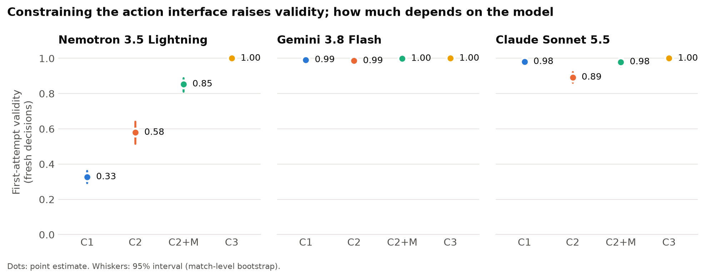

# Arbiter Arena

Arbiter Arena is an environment for testing how well AI models act as agents within a
system of strict rules, using Dungeons & Dragons combat as its setting.


## What this is

In each battle, an AI model controls one side. Every turn it is shown the state of the
board and proposes an action, which the rules engine either carries out or refuses, along
with the reason for the refusal. Every battle is seeded and recorded in full, so any result
can be replayed and checked decision by decision, and a model's reliability is something
the engine measures directly.

## Why it exists

I built Arbiter Arena because I wanted a way to run experiments, tests and benchmarks on
agentic AI in a setting which I could personally connect with. It began as a tool for game
masters to simulate how an encounter might play out, however while building it I found far
more interesting questions in how a model should be allowed to act at all, and the project
grew into a platform for answering them.

## Why D&D combat

I have played D&D extensively at the table, and it is one of the few settings I understand
deeply enough to build this kind of work around. It also happens to demand many of the same
skills which matter for AI agents more broadly. A model has to reason about space and
distance, keep track of resources such as whether it has already used its action this
turn, plan several turns ahead, and act under the uncertainty of dice rolls.

Its rules are complex but fully written down, and openly licensed through the SRD (the
System Reference Document), so every action can be checked automatically as legal or
illegal. Battles are seeded, so they can be replayed exactly, and they are cheap, at about
5 US cents per model match.

It is also easy to see what went wrong. A failure is visible at a glance on the board, and
every decision is recorded alongside the model's own reasoning, so it is possible to follow
not only what a model did but why it appears to have done it. With so much of AI still
something of a black box, I see that kind of observability as one of the setting's
strongest advantages.

Importantly, the problem has the same shape as that of an agent working in a booking
system, a CRM or a codebase. The model acts from a partial view of the world, within limits
on what it is permitted to do, and has to remember what it has already done.

## What I found

The first study keeps each model fixed and changes only how it is allowed to act: writing
its move as free text, calling tools, calling tools with the list of legal moves visible,
or picking from that list. Across 600 battles and three models, the main results were as
follows:

1. The interface took the small open-weight model (Nemotron) from 33% to 100% valid
   actions, and from 13 to 25 wins out of 40.
2. The flagship model (Claude Sonnet) was the only one to become less reliable with more
   structure, doing noticeably worse with bare tool calls than with free text.
3. Simply showing the list of legal actions, without restricting the model to it,
   recovered most of that loss, and was a cheap fix for both of the models which needed
   it.
4. Choosing from a menu cost far less than expected, and all but ended friendly fire with
   area spells.



The full write-up, including the match shown above, is in [the article](docs/ARTICLE.md).

## Watch a match

Both matches shown above are included in the repository, along with the model's reasoning at
every turn. After following the quick start below, run `uvicorn web.app:app` and open
`http://localhost:8000/playback?match=sonnet_kiting_seed108_C2.jsonl&step=21` to see the
turn where the model explains that it "can't do both in one action", with its words beside
the board.

## Where this is going

Arbiter Arena was built to be reused. The observation format, the interfaces, the rules
validator, the replay system and the study runner are all independent of this first study,
so new experiments can be built on top of them. The next experiments have not been decided
yet, however I am most interested in richer agentic studies, since I see agents as the most
relevant and interesting area of AI research and application right now.

## Writing

- [Show, don't make them guess](docs/ARTICLE.md): how the action interface shapes LLM
  agents in a tactical game. The write-up of the first study.

## About

I'm Logan Nilson, an independent AI developer and researcher, with a peer-reviewed paper on
LLM-based assessment of student work (ACE 2026), and a proud lifelong geek, which goes some
way to explaining why the test bed is D&D. [LinkedIn](https://www.linkedin.com/in/logan-nilson/)

---

## Quick start (no API key)

```bash
python -m venv .venv
# Windows: .venv\Scripts\activate    macOS/Linux: source .venv/bin/activate
pip install -e ".[web,dev]"

# Run the whole study pipeline against mock models: 60 matches, under a minute, no cost.
python -m src.arena.study run examples/study/demo.toml --out results/demo
python -m src.arena.study report results/demo      # metrics, CSVs and summary.md
python -m src.arena.study verify results/demo      # every match must replay: 100%
python -m src.arena.study show results/demo/mock/C1/aoe_placement/seed1.jsonl --refused
```

Use the venv's Python for every command. A system `python` without the dependencies installed fails in confusing ways.

To watch a match: run `uvicorn web.app:app`, open `http://localhost:8000/playback`, and use **Open…** to load any transcript. Drag to pan, scroll to zoom, and double-click to fit the board again. The replay shows the board, and for every model decision, what the model thought, wrote and called, and how the referee ruled.

Requires Python 3.11+. Real models need the `[agents]` extra and a key; see [AGENT_ARENA_LLM_SETUP.md](docs/current/AGENT_ARENA_LLM_SETUP.md).

---

## The first study in detail

Three models each played four tactical scenarios, ten seeds per cell, under four interface conditions. The engine, the scenarios and the opponent were identical across conditions; only the way the model expresses its action changed:

| Condition | The model… |
|---|---|
| **C1** free text | writes its action in prose, read by a fixed parser |
| **C2** tool calls | calls typed tools (`move`, `attack`, `cast_spell`, `end_turn`) with raw arguments |
| **C2+M** tools + menu | calls the same tools, and is also shown the list of legal options |
| **C3** menu | picks one option id from the enumerated legal actions |

The design, hypotheses, metrics and exclusions were frozen before the final run, at the `study-freeze` tag ([PREREGISTRATION.md](docs/current/PREREGISTRATION.md)). The final run was 600 matches (480 model, 120 baseline), with 100% replay verification and no exclusions.

**First-attempt action validity** (the share of fresh decisions the engine accepted):

| Model | C1 | C2 | C2+M | C3 |
|---|---|---|---|---|
| Nemotron 3.5 Lightning | 0.327 | 0.579 | 0.854 | 1.000 |
| Gemini 3.8 Flash | 0.991 | 0.986 | 0.999 | 1.000 |
| Claude Sonnet 5.5 | 0.981 | 0.893 | 0.979 | 1.000 |


Constraining the interface raises validity as predicted, but how much depends on the model. For the weakest model it is transformative (it wins 13 of 40 matches in C1 and 25 of 40 in C3); for the strongest it barely registers. Sonnet reverses one predicted step: it is worse with bare tool calls than with prose. The full write-up, including a worked failure case, is in [the article](docs/ARTICLE.md), and the working record is [FINAL_RUN_FINDINGS.md](docs/current/FINAL_RUN_FINDINGS.md).

### Check the results yourself

The complete data is a release asset: all 600 transcripts, the report, the blind parser audit, the exact prompt each condition was shown, and the pre-registration as frozen. Download [`arbiter-arena-study-1.0.0.zip`](https://github.com/Nitrix119/Arbiter-Arena/releases/download/v1.0.0/arbiter-arena-study-1.0.0.zip) from the [v1.0.0 release](https://github.com/Nitrix119/Arbiter-Arena/releases/tag/v1.0.0). Unzip it into the repository root, then:

```bash
python -m src.arena.study verify results/final   # every match must replay: 600/600
python -m src.arena.study report results/final   # rewrites report/ exactly
```

Neither command needs an API key. The bundle is built by `tools/make_bundle.py`, which refuses to export a prompt that no longer hashes to what the transcripts recorded.

### Limitations

- **One environment.** Tactical combat is a controlled setting, not a sample of real tool-use tasks.
- **Three models,** each at one setting. "Low" reasoning means different things per vendor, and sampling differs between providers (only Nemotron runs at temperature 0 with a seed).
- **Format and affordance are confounded.** The menu conditions change both how an action is written and what the model is shown.
- **The menu discretises** continuous choices (movement, area placement); it was measured to lose some options in some positions.
- **Tactics are underpowered,** and saturated for the strongest model.
- **No multiplicity correction** across the registered comparisons.
- **A known engine gap:** a move's path through a hostile creature is not checked, only where the move ends.

---

## How it works

```
observation ──► interface (C1 / C2 / C2+M / C3) ──► validator ──► executor ──► transcript
     ▲                                                  │ refusal + typed code      │
     └──────────────────── next decision ◄──────────────┘                   replay / report
```

- **Observation contract** (`observation.v1`): what an agent sees, with an `InformationPolicy` controlling what is hidden.
- **Legal-action enumeration**: every legal move, attack and spell placement with a stable id, which the menu conditions show and the validator checks against.
- **Validation with typed codes**: a refused action names why (`destination_blocked`, `out_of_range`, `no_effect`, `malformed_output`, …), and a failure budget ends a turn that keeps failing.
- **Recording**: per-request tokens, cost, latency, the model's raw output and reasoning (scrubbed for secrets), and a hash of the state after every turn.
- **Replay verification**: `study verify` re-runs each match from its recorded actions and checks every state hash.
- **Baselines**: Random, Scripted and a utility-scoring Heuristic agent play through the same paths, for free.

The full picture, with a diagram, is in [ARCHITECTURE.md](docs/ARCHITECTURE.md).

---

## The engine

The harness sits on a general SRD 5.1-compatible combat simulator. Every creature, spell and rule is JSON data.

- **Combat**: initiative, turn order and the action economy (actions, bonus actions, reactions, movement).
- **One resolution path**: spells, weapon attacks and rules are all a block `program`, validated when it loads and run by one evaluator. Unknown blocks, undeclared arguments and malformed expressions fail at load, naming the problem.
- **Reactive mechanics** ride a typed event bus: rules and effects subscribe to events such as `ATTACK_HIT` or `DAMAGE_INCOMING` and can modify or cancel them.
- **Area of effect**: sphere, cone, line, cylinder and cube geometry selects the targets inside a blast.
- **Damage types**: per-creature resistance, immunity and vulnerability.
- **Conditions and lasting effects**: concentration, buffs and debuffs, and conditions with durations.
- **Deterministic**: all randomness flows through one context-scoped, seedable RNG, so `CombatSystem(seed=…)` reproduces a battle exactly.
- **Expression sandbox**: computed fields in JSON run in a whitelisted AST sandbox with no builtins, imports or private attributes.
- **Web UI**: a FastAPI app with WebSocket sessions and a canvas front end for live battles, and the playback page for transcripts.

### Defining content

| Reference | What it covers |
|---|---|
| [Block Reference](docs/current/BLOCK_REFERENCE.md) | Every block a spell, attack or rule program can use, with its arguments. Generated from the code, so it cannot drift. |
| [Creature Definition Guide](examples/creatures/CREATURE_DEFINITION_GUIDE.md) | Stat blocks, abilities, saves, actions, spellcasting, damage modifiers, resources |
| [Animation Guide](examples/spells/ANIMATION_GUIDE.md) | The declarative canvas effects a spell can play |

Adding a spell is a JSON file in `examples/spells/`; adding an effect is a JSON file in `rules/entity_effects/`. Both are scanned at startup.

```python
from src.loaders import StatBlockLoader
from src.models import Entity
from src.combat import CombatSystem

goblin = Entity(StatBlockLoader.load_from_json("examples/creatures/goblin.json"))
wizard = Entity(
    StatBlockLoader.load_from_json("examples/creatures/characters/wizard.json"),
    team="players",
)

combat = CombatSystem(seed=7)
combat.add_combatant(goblin)
combat.add_combatant(wizard)
combat.start_combat()
```

---

## Project structure

```
src/
├── arena/       # The evaluation harness: observation, interfaces, executor, transcripts,
│                #   replay, metrics, the study runner and report, LLM adapters
│   └── heuristic/  # The utility-scoring baseline agent
├── combat/      # CombatSystem, turn order, attack and spell resolution, event bus
├── spells/      # The block engine: registry, validator, evaluator, blocks
├── rules/       # Rule data, loading and the expression sandbox
├── models/      # StatBlock (immutable template), Entity (per-battle state), actions
├── loaders/     # JSON stat block loading
├── spatial/     # Geometry, range and area of effect
└── utils/       # The seedable dice RNG
web/             # FastAPI app, WebSocket combat sessions, live and playback pages
examples/        # Creatures, spells, and the study grids (examples/study/)
rules/           # Global rules and entity effects, as JSON
docs/current/    # Design docs, the pre-registration and the study record
tests/           # pytest suite
```

## Development

[](https://github.com/Nitrix119/Arbiter-Arena/actions/workflows/ci.yml)

```bash
pytest tests/ -q            # the full suite
black src/ web/ tests/      # format (Black is pinned)
flake8 src/ web/ tests/     # lint, 88 columns
mypy src/                   # types
```

CI runs all four on every pull request. [CLAUDE.md](CLAUDE.md) holds the working rules for the codebase, human or agent.

---

## License

Licensed under the [Apache License 2.0](LICENSE). The SRD 5.1 game content stays under CC BY 4.0. Both attributions are in [NOTICE](NOTICE).

To cite the software or the study, see [CITATION.cff](CITATION.cff).

---

## Attribution and non-affiliation

This project is **not affiliated with, endorsed, sponsored, or approved by Wizards of the Coast LLC**. *Dungeons & Dragons* and *D&D* are trademarks of Wizards of the Coast LLC.

Game rules content is derived from the **System Reference Document 5.1 ("SRD 5.1")** by Wizards of the Coast LLC, available under the [Creative Commons Attribution 4.0 International License](https://creativecommons.org/licenses/by/4.0/legalcode). References to 5e rules in this repository are descriptive, for interoperability.
